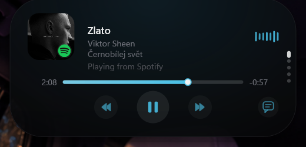
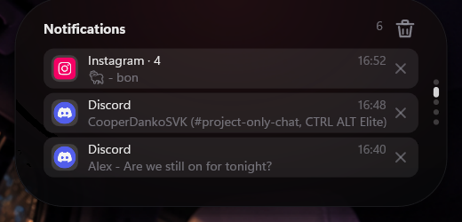
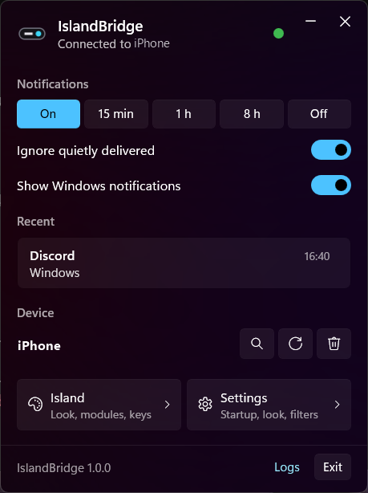
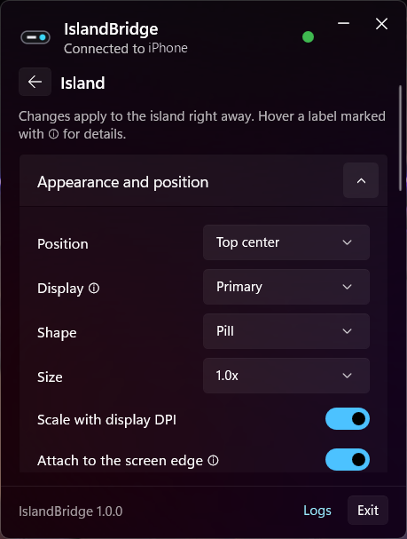

# IslandBridge

Your iPhone notifications in a Dynamic Island on Windows. No Phone Link, no cloud, no account.

<p align="center">
  
</p>

IslandBridge connects to your iPhone over Bluetooth and shows every notification in a small island at the top of the screen. Windows notifications land there too. Between notifications the island is a media player, a clock with weather and a notification center.

<p align="center">
  
  
</p>

## Features

- iPhone notifications through Apple's official Bluetooth notification service (ANCS)
- Windows notifications in the same island, with app icons
- media player with album art, lyrics and a visualizer
- notification center, clock, weather, calendar and more, all optional
- a small tray app with pause, filters per app and category, and every island setting
- English and Slovak

<p align="center">
  
  
</p>

## Install

1. Download `IslandBridge-1.0.0-setup-x64.exe` from [Releases](https://github.com/1Filipek2/island-bridge/releases) and run it. It installs for your user only, no admin needed. The installer is not signed yet, so Windows SmartScreen may ask you to confirm (More info, Run anyway).
2. Pair your iPhone with the PC in Windows Settings, Bluetooth & devices, if it is not paired yet.
3. Open IslandBridge from the tray and click the search button under Device to pick your iPhone.
4. On the iPhone, open Settings, Bluetooth, tap ⓘ next to your PC and turn on **Share System Notifications**.

Requires Windows 11 (x64) and an iPhone. A portable zip is on the Releases page too.

## Privacy

IslandBridge talks only to your paired iPhone and never goes online. Notification text stays on your PC and is never written to the logs. Some optional island modules use the internet: weather (Open-Meteo, OpenStreetMap), lyrics (LRCLIB), quick lookup (Wiktionary, Wikipedia) and the GitHub tab. Each can be turned off.

## Build from source

Needs the .NET 10 SDK, Visual Studio 2022 or later with the C++ desktop workload and Inno Setup 6.

```powershell
.\installer\build.ps1 -Version 1.0.0
```

The installer, the portable zip and checksums end up in `artifacts\release`.

## Credits and license

The island is based on [Dynamic Island for Windows](https://github.com/devcode90/Dynamic-Island-for-Windows) by Himanshu (devcode90). IslandBridge is released under the [MIT License](LICENSE); third-party notices are in [THIRD-PARTY-NOTICES.txt](THIRD-PARTY-NOTICES.txt).
